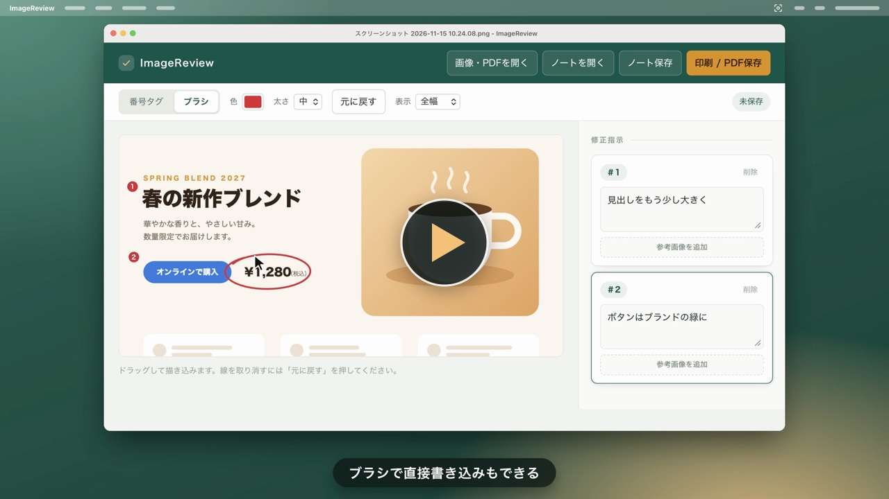

# ImageReview

画像や PDF に番号タグと手書きで修正指示を書き込み、印刷・PDF 保存できる Mac アプリです。スクリーンショットを撮って、そのまま書き込めます。

[](demo/ImageReview-demo.mp4)

画像をクリックすると、紹介動画（40 秒・音声なし）を再生できます。

## インストール

1. [Releases](https://github.com/Kobayasu31415/ImageReview/releases/latest) から `ImageReview-1.0.dmg` をダウンロードして開く
2. `ImageReview` を `Applications` フォルダにドラッグする
3. 初回だけ起動を許可する（Apple の公証を受けていないため、そのままでは警告が出て開けません）
   1. `ImageReview` を開く。警告が出るので「完了」で閉じる
   2. システム設定 ›「プライバシーとセキュリティ」を開き、下のほうにある「このまま開く」を押す
4. 初めてスクリーンショットを撮るときに「画面収録」の許可を求められるので、システム設定でオンにしてからアプリを起動し直す

ターミナルを使うなら、手順 3 の代わりに次のコマンドでも許可できます。

```bash
xattr -dr com.apple.quarantine /Applications/ImageReview.app
```

対応は macOS 13 以降です。動作確認は Apple シリコンの macOS 27 でのみ行っていて、Intel Mac は未確認です。

## 使い方

- **Finder から開く**: 画像（PNG / JPEG / WebP / GIF / BMP）や PDF を右クリック →「このアプリケーションで開く」→ ImageReview
- **スクリーンショット**: `⌘⇧7` 画面全体 / `⌘⇧8` 範囲を選択 / `⌘⇧9` ウインドウを選択。撮った画像がそのまま開きます
- **常駐**: ウインドウを閉じてもメニューバーに残ります。メニューバーのアイコンから、ショートカットの変更と個別オフ、ログイン時の起動を設定できます

## ソースからビルド

Xcode は不要で、Command Line Tools（`xcode-select --install`）があればビルドできます。

```bash
./macapp/build.sh        # ビルドして /Applications にインストール
./macapp/build.sh --dmg  # 配布用の dmg を dist/ に作成
```

編集画面だけなら、`index.html` をブラウザーで開いても使えます。
